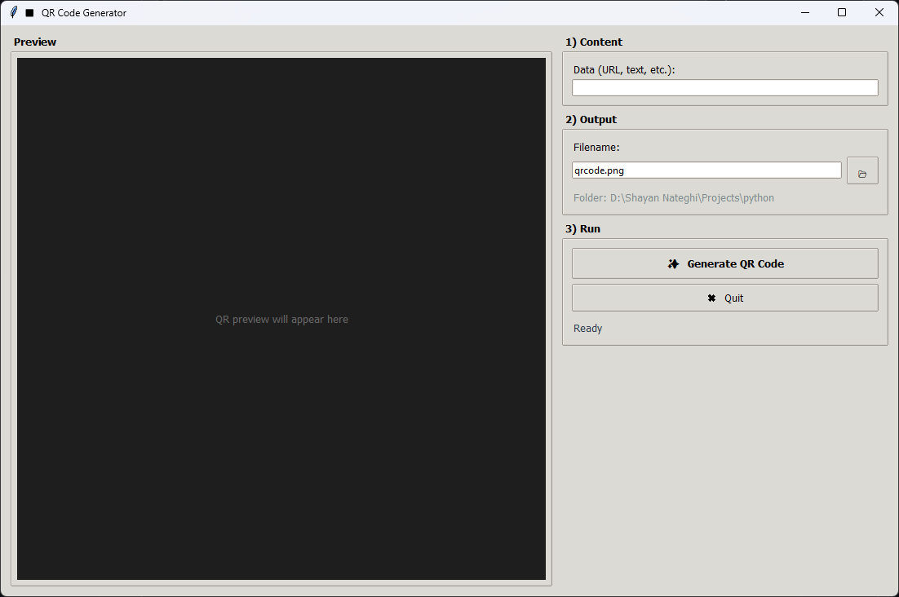

<!-- Improved compatibility of back to top link: See: https://github.com/othneildrew/Best-README-Template/pull/73 -->
<a id="readme-top"></a>
<!--
*** Thanks for checking out the Best-README-Template. If you have a suggestion
*** that would make this better, please fork the repo and create a pull request
*** or simply open an issue with the tag "enhancement".
*** Don't forget to give the project a star!
*** Thanks again! Now go create something AMAZING! :D
-->


<!-- PROJECT SHIELDS -->
<!--
*** I'm using markdown "reference style" links for readability.
*** Reference links are enclosed in brackets [ ] instead of parentheses ( ).
*** See the bottom of this document for the declaration of the reference variables
*** for contributors-url, forks-url, etc. This is an optional, concise syntax you may use.
*** https://www.markdownguide.org/basic-syntax/#reference-style-links
-->
[![Contributors][contributors-shield]][contributors-url]
[![Forks][forks-shield]][forks-url]
[![Stargazers][stars-shield]][stars-url]
[![Issues][issues-shield]][issues-url]
[![project_license][license-shield]][license-url]
[![LinkedIn][linkedin-shield]][linkedin-url]


<!-- PROJECT LOGO -->
<br />
<div align="center">
  <a href="https://github.com/ARGDeveloperShayan/qr-code-generator">
    
  </a>

<h3 align="center">QR Code Generator</h3>

  <p align="center">
    A desktop GUI application that turns text, URLs, or any data into scannable QR codes — with live preview and one-click save.
    <br />
    <a href="https://github.com/ARGDeveloperShayan/qr-code-generator"><strong>Explore the docs »</strong></a>
    <br />
    <br />
    <a href="https://github.com/ARGDeveloperShayan/qr-code-generator">View Demo</a>
    &middot;
    <a href="https://github.com/ARGDeveloperShayan/qr-code-generator/issues/new?labels=bug&template=bug-report---.md">Report Bug</a>
    &middot;
    <a href="https://github.com/ARGDeveloperShayan/qr-code-generator/issues/new?labels=enhancement&template=feature-request---.md">Request Feature</a>
  </p>
</div>


<!-- TABLE OF CONTENTS -->
<details>
  <summary>Table of Contents</summary>
  <ol>
    <li>
      <a href="#about-the-project">About The Project</a>
      <ul>
        <li><a href="#built-with">Built With</a></li>
      </ul>
    </li>
    <li>
      <a href="#getting-started">Getting Started</a>
      <ul>
        <li><a href="#prerequisites">Prerequisites</a></li>
        <li><a href="#installation">Installation</a></li>
      </ul>
    </li>
    <li><a href="#usage">Usage</a></li>
    <li><a href="#roadmap">Roadmap</a></li>
    <li><a href="#contributing">Contributing</a></li>
    <li><a href="#license">License</a></li>
    <li><a href="#contact">Contact</a></li>
    <li><a href="#acknowledgments">Acknowledgments</a></li>
  </ol>
</details>


<!-- ABOUT THE PROJECT -->
## About The Project

A lightweight, single-file Python application for generating QR codes from any text or URL. Unlike minimal scripts that only save a file, this tool provides a full Tkinter interface with a real-time canvas preview, a native file-save dialog, and automatic filename sanitization — so the generated image is ready to use immediately.

It uses the `qrcode` library for generation and `Pillow` for image handling and display. The interface is split into three clear steps — Content, Output, and Run — so the workflow is obvious even on first launch.

<p align="right">(<a href="#readme-top">back to top</a>)</p>


### Built With

* [![Python][Python.py]][Python-url]
* [![Tkinter][Tkinter.py]][Tkinter-url]
* [![qrcode][qrcode.py]][qrcode-url]
* [![Pillow][Pillow.py]][Pillow-url]

<p align="right">(<a href="#readme-top">back to top</a>)</p>


<!-- GETTING STARTED -->
## Getting Started

The application runs on any system with Python 3 and a working Tkinter installation. No build step is required — it is a single Python file.

### Prerequisites

* **Python 3.6 or newer** — Tkinter ships with most official Python installers. On some Linux distributions, install it separately:
  ```sh
  # Debian / Ubuntu
  sudo apt install python3-tk
  ```
* **pip** — for installing the two image dependencies:
  ```sh
  python -m ensurepip --upgrade
  ```

### Installation

1. Clone the repository:
   ```sh
   git clone https://github.com/ARGDeveloperShayan/qr-code-generator.git
   cd qr-code-generator
   ```
2. Install the required packages:
   ```sh
   pip install qrcode pillow
   ```
   The script checks these at startup and shows a clear error message if either is missing.
3. Run the application:
   ```sh
   python import_os.py
   ```
   (Replace `import_os.py` with the actual filename of your script.)

<p align="right">(<a href="#readme-top">back to top</a>)</p>


<!-- USAGE EXAMPLES -->
## Usage

1. **Enter your content** — paste a URL, plain text, or any string into the *Data* field.
2. **Choose an output location** — type a filename or click the 📂 button to open a save dialog. The folder indicator updates automatically.
3. **Click “✨ Generate QR Code”** — the QR is saved to disk and a thumbnail preview appears on the dark canvas.

**Key behaviours from the implementation:**

- If the filename field is left blank, the app automatically derives a safe filename from the input data (stripping `\ / * ? : " < > |`).
- The preview is redrawn whenever the window is resized, so it stays centered without distortion.
- The generated image is converted to RGB before saving, which avoids transparency artefacts in downstream tools.

**Error handling:**

- Empty input triggers a blocking message box instead of silently failing.
- If the save path is unwritable, the status bar turns red and the full exception is shown in an error dialog.

<p align="right">(<a href="#readme-top">back to top</a>)</p>


<!-- ROADMAP -->
## Roadmap

- [x] Live QR preview on a resizable Tkinter canvas
- [x] Native save dialog with folder selection
- [x] Automatic filename sanitization
- [ ] Add error-correction level selector (L / M / Q / H)
- [ ] Add foreground and background colour pickers
- [ ] Add batch generation from a CSV column
- [ ] Export as SVG for print workflows

See the [open issues](https://github.com/ARGDeveloperShayan/qr-code-generator/issues) for a full list of proposed features (and known issues).

<p align="right">(<a href="#readme-top">back to top</a>)</p>


<!-- CONTRIBUTING -->
## Contributing

Contributions are what make the open source community such an amazing place to learn, inspire, and create. Any contributions you make are **greatly appreciated**.

If you have a suggestion that would make this better, please fork the repo and create a pull request. You can also simply open an issue with the tag "enhancement".
Don't forget to give the project a star! Thanks again!

1. Fork the Project
2. Create your Feature Branch (`git checkout -b feature/AmazingFeature`)
3. Commit your Changes (`git commit -m 'Add some AmazingFeature'`)
4. Push to the Branch (`git push origin feature/AmazingFeature`)
5. Open a Pull Request

<p align="right">(<a href="#readme-top">back to top</a>)</p>

### Top contributors:

<a href="https://github.com/ARGDeveloperShayan/qr-code-generator/graphs/contributors">
  
</a>


<!-- LICENSE -->
## License

Distributed under the MIT License. See `LICENSE.txt` for more information.

<p align="right">(<a href="#readme-top">back to top</a>)</p>


<!-- CONTACT -->
## Contact

Your Name - shayannateghi90@gmail.com

Project Link: [https://github.com/ARGDeveloperShayan/qr-code-generator](https://github.com/ARGDeveloperShayan/qr-code-generator)

<p align="right">(<a href="#readme-top">back to top</a>)</p>


<!-- ACKNOWLEDGMENTS -->
## Acknowledgments

* [Best-README-Template](https://github.com/othneildrew/Best-README-Template) — structure and badge conventions used in this file
* [qrcode](https://github.com/lincolnloop/python-qrcode) — the QR generation engine
* [Pillow](https://python-pillow.org/) — image conversion and Tkinter-compatible preview
* [Shields.io](https://shields.io) — repository badges

<p align="right">(<a href="#readme-top">back to top</a>)</p>


<!-- MARKDOWN LINKS & IMAGES -->
<!-- https://www.markdownguide.org/basic-syntax/#reference-style-links -->
[contributors-shield]: https://img.shields.io/github/contributors/ARGDeveloperShayan/qr-code-generator.svg?style=for-the-badge
[contributors-url]: https://github.com/ARGDeveloperShayan/qr-code-generator/graphs/contributors
[forks-shield]: https://img.shields.io/github/forks/ARGDeveloperShayan/qr-code-generator.svg?style=for-the-badge
[forks-url]: https://github.com/ARGDeveloperShayan/qr-code-generator/network/members
[stars-shield]: https://img.shields.io/github/stars/ARGDeveloperShayan/qr-code-generator.svg?style=for-the-badge
[stars-url]: https://github.com/ARGDeveloperShayan/qr-code-generator/stargazers
[issues-shield]: https://img.shields.io/github/issues/ARGDeveloperShayan/qr-code-generator.svg?style=for-the-badge
[issues-url]: https://github.com/ARGDeveloperShayan/qr-code-generator/issues
[license-shield]: https://img.shields.io/github/license/ARGDeveloperShayan/qr-code-generator.svg?style=for-the-badge
[license-url]: https://github.com/ARGDeveloperShayan/qr-code-generator/blob/master/LICENSE.txt
[linkedin-shield]: https://img.shields.io/badge/-LinkedIn-black.svg?style=for-the-badge&logo=linkedin&colorB=555
[linkedin-url]: https://linkedin.com/in/your_linkedin_username
[product-screenshot]: images/screenshot.png
[Python.py]: https://img.shields.io/badge/Python-3776AB?style=for-the-badge&logo=python&logoColor=white
[Python-url]: https://www.python.org/
[Tkinter.py]: https://img.shields.io/badge/Tkinter-FF6F00?style=for-the-badge&logo=python&logoColor=white
[Tkinter-url]: https://docs.python.org/3/library/tkinter.html
[qrcode.py]: https://img.shields.io/badge/qrcode-2C3E50?style=for-the-badge&logo=python&logoColor=white
[qrcode-url]: https://github.com/lincolnloop/python-qrcode
[Pillow.py]: https://img.shields.io/badge/Pillow-5A9FD4?style=for-the-badge&logo=python&logoColor=white
[Pillow-url]: https://python-pillow.org/
